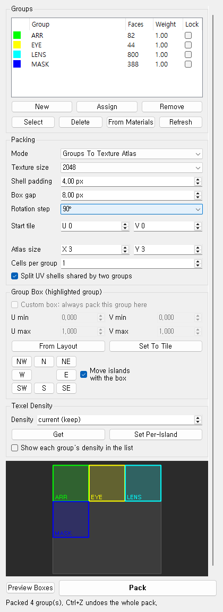
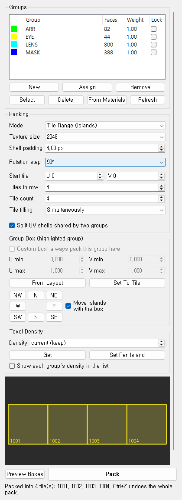
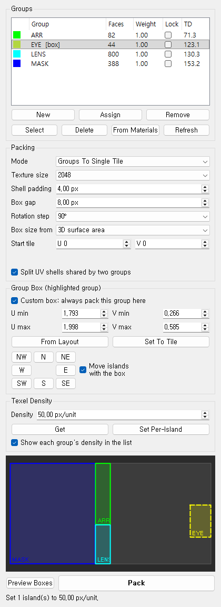

# UV Group Packer (Maya)

UVPackmaster 4의 그룹/타일 패킹 기능을 참고해서 만든 마야 UV 패킹 툴입니다.
UV를 그룹(재질/파츠)으로 나눠 그룹마다 **별도의 영역(Box)** 에 패킹하거나,
아일랜드를 **여러 UDIM 타일에 같은 텍셀 밀도로** 나눠 담습니다.
라이트맵 UV, 아틀라스 텍스처, UDIM 에셋처럼 텍스처를 영역별로 나눠 써야 할 때 유용합니다.

패킹 엔진은 마야 내장 Unfold3D(`u3dLayout`)를 사용하므로 별도 설치나 라이선스가 필요 없습니다.

| Groups To Single Tile | Texture Atlas | Tile Range | Group Box + TD |
|---|---|---|---|
|  |  |  |  |

## 기능

- **그룹 관리**: 선택한 면/오브젝트로 그룹 만들기, 할당, 제거, 선택, 삭제
  - 그룹은 씬 안에 `UVGP_<이름>` objectSet으로 저장됩니다. 파일을 저장하면 그룹도 같이 저장됩니다.
  - 한 면은 한 그룹에만 속합니다. 다른 그룹에 Assign하면 원래 그룹에서 자동으로 빠집니다.
- **From Materials**: 재질마다 그룹을 하나씩 자동으로 만듭니다. 그룹 색도 재질 색을 따릅니다.
- **Groups To Single Tile**: 그룹별 3D 면적(또는 현재 UV 면적)에 비례해 타일을 박스로 나누고, 각 그룹을 자기 박스 안에만 패킹합니다.
- **Groups To Tiles (UDIM)**: 그룹마다 UDIM 타일을 하나씩 배정합니다(Tiles in row 칸마다 다음 줄).
- **Groups To Texture Atlas**: 타일을 X×Y 격자로 나누고 그룹마다 셀을 배정합니다(왼쪽 위부터). Cells per group으로 그룹당 셀 수를 정합니다.
- **Dynamic Tiles (islands)**: 지정한 텍셀 밀도를 유지한 채 아일랜드를 **필요한 만큼의 타일**에 나눠 담습니다. 모자라면 타일을 자동으로 늘립니다.
- **Tile Range (islands)**: 시작 타일 + 타일 수 범위 안에 아일랜드를 나눠 담고, 모든 타일이 **같은 텍셀 밀도**(들어가는 최대값)가 되게 맞춥니다.
- **Tile filling**: Simultaneously(모든 타일을 고르게) / Sequentially(앞 타일부터 채움).
- **Group Box**: 그룹마다 직접 박스를 지정할 수 있습니다(UVPackmaster의 Group Target Box). 좌표 입력, From Layout, Set To Tile, NW~SE 버튼으로 옆 타일로 이동(아일랜드도 같이 이동 가능). 커스텀 박스는 점선으로 미리보기됩니다.
- **Texel Density**: 선택의 평균 밀도 읽기(Get), 아일랜드마다 같은 밀도로 맞추기(Set Per-Island), 그룹별 밀도를 리스트에 표시(Show).
- **Weight**: 그룹별 가중치입니다. 그룹 모드에서는 박스가 커지고, 아일랜드 모드에서는 **텍셀 밀도 배수(Texel Density Tiers)** 로 쓰입니다(Weight 2 = 두 배 밀도).
- **Lock**: 잠근 그룹은 움직이지 않습니다.
- **Split shared shells**: 두 그룹에 걸친 UV 셸은 그룹 경계를 따라 자동으로 컷합니다.
- **Preview Boxes**: 패킹하기 전에 박스 배치를 창 안에서 미리 볼 수 있습니다.
- 한 번의 **Ctrl+Z** 로 패킹 전체를 되돌립니다.

## 설치

1. 이 저장소를 받습니다.
   ```bash
   git clone https://github.com/9amechoung/MayaPakingTools.git
   ```
2. `UVGroupPacker/install.py` 를 마야 뷰포트로 **드래그 앤 드롭**합니다.
3. 현재 셸프에 **UVGP** 버튼이 생기고 창이 열립니다.

수동으로 실행하려면 스크립트 에디터(Python)에서:

```python
import sys
sys.path.insert(0, r"<저장소 경로>/UVGroupPacker/scripts")
import uv_group_packer
uv_group_packer.show()
```

## 사용법 (영상 순서와 동일)

1. **From Materials** 를 누르거나, 면을 선택하고 **New** 를 눌러 그룹을 만듭니다.
   - 면 선택 → 리스트에서 그룹 클릭 → **Assign** 하면 그 그룹으로 옮겨집니다.
   - 리스트에서 그룹을 클릭하면 그 그룹의 면이 선택됩니다.
2. Mode를 **Groups To Single Tile** 로 둡니다.
3. **Preview Boxes** 로 배치를 확인하고, 필요하면 Weight를 조절합니다(더블클릭해서 편집).
4. **Pack** 을 누릅니다.

### 아일랜드 모드 (Dynamic Tiles / Tile Range)

- 패킹 대상: **선택이 있으면 선택**, 없으면 잠기지 않은 **모든 그룹**(그룹 Weight가 밀도 배수), 그룹도 없으면 **씬 전체 메시**.
- Dynamic Tiles: Texel Density의 Density 값으로 패킹합니다. 0(current)이면 지금 평균 밀도를 유지합니다.
  한 아일랜드가 타일 한 장보다 크면 그 밀도는 불가능하므로 전체를 같은 비율로 줄입니다.
- Tile Range: Start tile, Tile count, Tiles in row로 범위를 정합니다.

### 그룹 박스 직접 지정

1. 리스트에서 그룹을 클릭합니다.
2. **From Layout** 으로 자동 배치 박스를 가져오거나 좌표를 입력하고 **Custom box** 를 켭니다.
3. NW/N/NE/W/E/SW/S/SE 로 옆 타일로 옮깁니다. **Move islands with the box** 가 켜져 있으면 UV도 같이 옮겨집니다.
4. 커스텀 박스가 있는 그룹은 어떤 그룹 모드에서든 그 박스 안에 패킹되고, 나머지 그룹은 자동 배치됩니다.

### 옵션

| 옵션 | 설명 |
|---|---|
| Texture size | 패딩(px)을 UV 단위로 바꿀 때 쓰는 텍스처 해상도 |
| Shell padding | 셸 사이 간격 (px) |
| Box gap | 박스(그룹) 사이 간격 (px) |
| Rotation step | 패킹 시 회전 허용 단위 (90° / 45° / 회전 없음) |
| Box size from | 박스 크기 기준: 3D 표면적(텍셀 밀도 균일) 또는 현재 UV 면적 |
| Start tile | 패킹할 타일 위치 (U, V). UDIM/아일랜드 모드에서는 시작 타일 |
| Tiles in row | 한 줄에 놓을 타일 수 (UDIM, Dynamic Tiles, Tile Range) |
| Tile count | Tile Range에서 쓸 타일 수 |
| Tile filling | Simultaneously / Sequentially |
| Atlas size | 아틀라스 격자 X×Y |
| Cells per group | 아틀라스에서 그룹당 셀 수 (한 줄보다 크면 여러 줄 블록) |
| Density | 텍셀 밀도 (px/unit, 마야 기본 단위 cm면 px/cm). Texture size 기준 |

## 제한 사항 / 다음 버전 후보

- 박스는 좌표 입력/버튼으로만 편집합니다. 미리보기에서 마우스로 그리거나 끌기는 아직 없습니다.
- 패킹 품질은 마야 `u3dLayout` 수준입니다(UVPackmaster의 GPU 휴리스틱 탐색은 없음).
- 잠근(Lock) 그룹은 Single Tile 모드에서 공간을 예약하지 않습니다. 겹치지 않게 하려면 UDIM 모드와 함께 쓰는 것이 좋습니다.
- 아일랜드별 밀도 값을 뷰포트에 숫자로 띄우는 기능(Show Is.TD)은 없고, 그룹별 밀도만 리스트에 표시합니다.
- UVPackmaster의 Align To Unselected(유사 아일랜드 정렬), 스태킹, 셸 우선순위, 3D 방향 정렬 등은 아직 구현하지 않았습니다.

## 테스트

```bash
python -m unittest discover tests
```

```bash
"C:/Program Files/Autodesk/Maya2025/bin/mayapy.exe" tests/maya_integration_test.py
```

Maya 2024, Maya 2025에서 통합 테스트를 통과했습니다.
