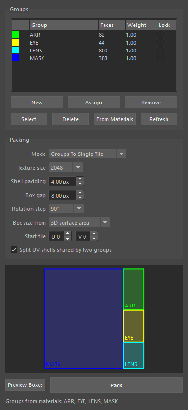
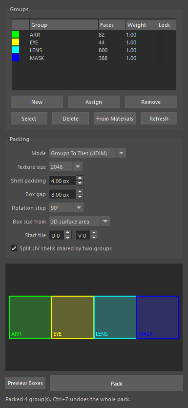

# UV Group Packer (Maya)

UVPackmaster의 **Groups To Single Tile** 기능을 참고해서 만든 마야 UV 패킹 툴입니다.
UV를 그룹(재질/파츠)으로 나누고, 한 타일 안에서 그룹마다 **별도의 직사각형 영역(Box)** 에 자동으로 패킹합니다.
라이트맵 UV, 아틀라스 텍스처처럼 한 장을 영역별로 나눠 써야 할 때 유용합니다.

패킹 엔진은 마야 내장 Unfold3D(`u3dLayout`)를 사용하므로 별도 설치나 라이선스가 필요 없습니다.

| Groups To Single Tile | Groups To Tiles (UDIM) |
|---|---|
|  |  |

## 기능

- **그룹 관리**: 선택한 면/오브젝트로 그룹 만들기, 할당, 제거, 선택, 삭제
  - 그룹은 씬 안에 `UVGP_<이름>` objectSet으로 저장됩니다. 파일을 저장하면 그룹도 같이 저장됩니다.
  - 한 면은 한 그룹에만 속합니다. 다른 그룹에 Assign하면 원래 그룹에서 자동으로 빠집니다.
- **From Materials**: 재질마다 그룹을 하나씩 자동으로 만듭니다. 그룹 색도 재질 색을 따릅니다.
- **Groups To Single Tile**: 그룹별 3D 면적(또는 현재 UV 면적)에 비례해 타일을 박스로 나누고, 각 그룹을 자기 박스 안에만 패킹합니다.
- **Groups To Tiles (UDIM)**: 그룹마다 UDIM 타일을 하나씩 배정합니다(가로 10칸 뒤 다음 줄).
- **Weight**: 그룹별 가중치입니다. 값을 키우면 박스가 커지고 텍셀 밀도가 올라갑니다.
- **Lock**: 잠근 그룹은 움직이지 않습니다.
- **Split shared shells**: 두 그룹에 걸친 UV 셸은 그룹 경계를 따라 자동으로 컷합니다.
- **Preview Boxes**: 패킹하기 전에 박스 배치를 창 안에서 미리 볼 수 있습니다.
- 한 번의 **Ctrl+Z** 로 패킹 전체를 되돌립니다.

## 설치

1. 이 저장소를 받습니다.
   ```bash
   git clone https://github.com/9amechoung/MayaPlugin.git
   ```
2. `UVGroupPacker/install.py` 를 마야 뷰포트로 **드래그 앤 드롭**합니다.
3. 현재 셸프에 **UVGP** 버튼이 생기고 창이 열립니다.

수동으로 실행하려면 스크립트 에디터(Python)에서:

```python
import sys
sys.path.insert(0, r"<저장소 경로>/UVGroupPacker/scripts")
import uv_group_packer
uv_group_packer.show()
```

## 사용법 (영상 순서와 동일)

1. **From Materials** 를 누르거나, 면을 선택하고 **New** 를 눌러 그룹을 만듭니다.
   - 면 선택 → 리스트에서 그룹 클릭 → **Assign** 하면 그 그룹으로 옮겨집니다.
   - 리스트에서 그룹을 클릭하면 그 그룹의 면이 선택됩니다.
2. Mode를 **Groups To Single Tile** 로 둡니다.
3. **Preview Boxes** 로 배치를 확인하고, 필요하면 Weight를 조절합니다(더블클릭해서 편집).
4. **Pack** 을 누릅니다.

### 옵션

| 옵션 | 설명 |
|---|---|
| Texture size | 패딩(px)을 UV 단위로 바꿀 때 쓰는 텍스처 해상도 |
| Shell padding | 셸 사이 간격 (px) |
| Box gap | 박스(그룹) 사이 간격 (px) |
| Rotation step | 패킹 시 회전 허용 단위 (90° / 45° / 회전 없음) |
| Box size from | 박스 크기 기준: 3D 표면적(텍셀 밀도 균일) 또는 현재 UV 면적 |
| Start tile | 패킹할 타일 위치 (U, V). UDIM 모드에서는 시작 타일 |

## 제한 사항 / 다음 버전 후보

- 박스 배치는 자동 분할(가로·세로 이분할)만 됩니다. 박스를 손으로 그리거나 옮기는 기능은 아직 없습니다.
- 패킹 품질은 마야 `u3dLayout` 수준입니다(UVPackmaster의 GPU 휴리스틱 탐색은 없음).
- 잠근(Lock) 그룹은 Single Tile 모드에서 공간을 예약하지 않습니다. 겹치지 않게 하려면 UDIM 모드와 함께 쓰는 것이 좋습니다.
- UVPackmaster의 스태킹, 유사도 그룹, 셸 우선순위, 3D 방향 정렬 등은 아직 구현하지 않았습니다.

## 테스트

```bash
python -m unittest discover tests
```

```bash
"C:/Program Files/Autodesk/Maya2025/bin/mayapy.exe" tests/maya_integration_test.py
```

Maya 2024, Maya 2025에서 통합 테스트를 통과했습니다.
